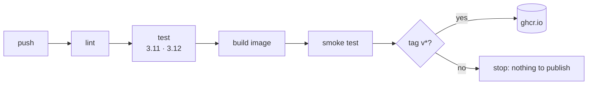

# INF 345 — Fundamentals of DevOps

## Lecture 12: Building & Testing Pipelines

<div class="pt-8 opacity-70">
Adil Akhmetov · Lesson 12
</div>

---
layout: default
---

# Recap — Lesson 11 (your first pipeline)

<v-clicks>

- Your `ci.yml` has `on: push` only. A teammate opens a pull request from a fork — does CI run? <span v-click class="opacity-60">(no — add `pull_request:` too)</span>
- How do you make `test` wait until `lint` passed? <span v-click class="opacity-60">(`needs: lint`)</span>
- The matrix says `python-version: [3.10, 3.12]`. Which versions run? <span v-click class="opacity-60">(3.1 and 3.12 — unquoted `3.10` is the number 3.1: quote it)</span>
- Cache vs artifact — which one would you use for a test report? <span v-click class="opacity-60">(artifact: a result you want to download; a cache only speeds up the next run)</span>

</v-clicks>

---
---

# Today's agenda

<v-clicks>

- [ ] From "tests pass" to "something we can ship"
- [ ] Tests that mean something: coverage and gates
- [ ] Building the container image in CI
- [ ] Testing the **image**, not just the code: smoke tests
- [ ] Publishing to GHCR — only for a release tag
- [ ] Pipeline hygiene: concurrency, timeouts, required checks
- [ ] Reading a red pipeline
- [ ] Straight into today's practice — and **Lab 03** (due next week)

</v-clicks>

---
layout: center
class: text-center
---

# The scenario

<div class="text-lg text-left mt-4 max-w-2xl mx-auto">

Last week `textkit` got a pipeline: lint, then tests on two Python
versions. Green checkmark. But nobody can **run** a green checkmark.
The team wants an image they can pull — built the same way every time,
tested before anyone sees it, published only when someone tags a release.

</div>

<div v-click class="mt-8 text-xl font-bold">
Today: the pipeline stops answering "is the code OK?" and starts
producing the thing we ship.
</div>

---
layout: section
transition: slide-left
---

# Block 1
## What a pipeline produces

---
---

# CI checks code. A build pipeline makes an artifact.



<v-clicks>

- Last week's worked example sketched **build → smoke test**; your practice stopped at **test**. Today: all of it, properly — plus **publish**.
- Next week adds a **security scan** between smoke test and publish.
- Every arrow is a `needs:` — a later job never runs on a failed earlier one.

</v-clicks>

---
---

# Build once, use everywhere

<div class="grid grid-cols-2 gap-6 text-sm">
<div>

### On a laptop

```bash
docker build -t textkit .
```

- which commit? which Python? which base image that day?
- "works on my machine" — and only there

</div>
<div v-click>

### In the pipeline

```bash
docker build -t textkit:3f9c2e1 .
```

- built from **one exact commit**, on a clean runner
- the tag says which commit it is
- the image that was tested **is** the image that ships

</div>
</div>

<div v-click class="mt-6 text-center text-lg">
An artifact you can't trace back to a commit is a mystery box.
</div>

---
layout: section
transition: slide-left
---

# Block 2
## Tests that mean something

---
---

# Green tests can still test nothing

```python
def test_textkit():
    import textkit          # passes — and checks nothing
```

<v-clicks>

- A test suite is only as good as what it **exercises**.
- **Coverage** = which lines ran during the tests.
- It doesn't prove the code is right — it shows what was **never even run**.

</v-clicks>

<div v-click class="mt-6">

```bash
pip install pytest-cov
pytest --cov=textkit --cov-report=term-missing
```

```text
Name                  Stmts   Miss  Cover   Missing
---------------------------------------------------
textkit/__init__.py      16      3    81%   18, 33-34
```

</div>

---
---

# A gate is a check that can say "no"

```yaml {4}
      - run: pip install -r requirements.txt
      - run: >
          pytest
          --cov=textkit --cov-fail-under=90
          --junitxml=report-${{ matrix.python-version }}.xml
```

<v-clicks>

- Below 90% → pytest exits with an error → the job is **red**.
- Pick a number the project meets **today**, then never let it drop.
- 100% isn't the goal: the goal is "new code comes with tests".
- `term-missing` tells you **which** lines to test next.

</v-clicks>

---
---

# Matrix, a bit further

```yaml {3|4-7|8-10}
    strategy:
      matrix:
        python-version: ["3.11", "3.12"]
        os: [ubuntu-latest]
        include:
          - python-version: "3.13"
            experimental: true
      fail-fast: false
    continue-on-error: ${{ matrix.experimental == true }}
```

<v-clicks>

- `include` adds one extra combination — here a newer Python, allowed to fail.
- `fail-fast: false` — one red version doesn't cancel the others. You see **all** failures at once.
- Every combination costs runner minutes: test what you actually support.

</v-clicks>

---
layout: center
class: text-center
---

# Quick check

<div class="text-xl mt-4 max-w-2xl mx-auto text-left">

Coverage is 95%, the gate is 90%, CI is green. A student adds a new
function with no test. Coverage drops to 88%. What happens — and what's
the fix?

</div>

<div v-click class="mt-8 text-lg opacity-70">

The test job goes **red**: 88 < 90. The fix is a test for the new
function — **not** lowering `--cov-fail-under`.

</div>

---
layout: section
transition: slide-left
---

# Block 3
## Building the image in CI

---
---

# The build job

```yaml {1-3|4-5|6-7}
  build:
    needs: test
    runs-on: ubuntu-latest
    steps:
      - uses: actions/checkout@v4
      - run: docker build -t textkit:${{ github.sha }} .
```

<v-clicks>

- `needs: test` — no image from untested code.
- Docker and Podman are both on `ubuntu-latest` — last week's example used `podman build`; either works.
- `github.sha` — the full commit hash. Every build gets its own tag.
- `latest` means "whatever was pushed last" — useless for knowing **what** runs.

</v-clicks>

---
---

# Your `Containerfile`, as CI sees it

```dockerfile {1|2-3|4-5|6}
FROM python:3.12-slim
WORKDIR /app
COPY textkit/ textkit/
RUN useradd --create-home app
USER app
ENTRYPOINT ["python", "-m", "textkit"]
```

<v-clicks>

- Same file, same result — on your laptop and on the runner.
- `USER app` — the container doesn't run as root (Lecture 6).
- `ENTRYPOINT`: the image **is** the CLI — `docker run textkit slugify "Hi there"` runs `python -m textkit slugify "Hi there"`.
- A `.dockerignore` (`.git`, `.venv`, `__pycache__`) keeps the build context small.

</v-clicks>

---
---

# Faster builds: layer cache

<div class="grid grid-cols-2 gap-6 text-sm">
<div>

Every runner starts **empty** — no layers from last time. Each build
downloads the base image and redoes every step.

Order matters, as in Lecture 4:

```dockerfile
COPY requirements.txt .
RUN pip install -r requirements.txt   # cached while deps don't change
COPY textkit/ textkit/                # changes every commit
```

</div>
<div v-click>

The official action can keep layers in the **Actions cache**:

```yaml
      - uses: docker/setup-buildx-action@v3
      - uses: docker/build-push-action@v6
        with:
          context: .
          load: true          # keep it in the local docker
          tags: textkit:${{ github.sha }}
          cache-from: type=gha
          cache-to: type=gha,mode=max
```

Same result as `docker build` — just faster on the second run.

</div>
</div>

---
layout: section
transition: slide-left
---

# Block 4
## Test the image, not just the code

---
---

# The tests passed. Does the image work?

<v-clicks>

- `pytest` ran the code on the **runner's** Python — not inside the image.
- What can still be broken in the image?
  - a file not `COPY`ed
  - a wrong `ENTRYPOINT`
  - a missing dependency that only your laptop had
  - a permission problem as the non-root user
- A **smoke test**: start the image once, check one real answer.
- Not the full test suite — a few seconds that catch "it doesn't even start".

</v-clicks>

---
---

# A smoke test for a command-line image

```yaml {1-2|3-7}
      - name: Smoke test
        run: |
          out=$(docker run --rm textkit:${{ github.sha }} slugify "Hello, DevOps World!")
          echo "got: $out"
          test "$out" = "hello-devops-world"
```

<v-clicks>

- `test a = b` exits 1 when they differ → the step fails → the job is red.
- Compare the **exact** output, not "something was printed".
- `echo` first: when it fails, the log shows what you actually got.

</v-clicks>

---
---

# A smoke test for a web service (Lab 03)

```bash {1|2-5|6}
docker run -d --name app -p 8080:8080 notes:${{ github.sha }}
for i in $(seq 1 30); do                       # wait until it's up
  curl -fsS http://localhost:8080/health && break
  sleep 1
done
curl -fsS http://localhost:8080/health          # -f: an HTTP error fails the step
```

<v-clicks>

- A server takes a moment to start — **retry**. Last week's `sleep 3` works until the day the runner is slow.
- `curl -f` turns a 500 into a failed step.
- On failure, print the logs: `docker logs app` (in a step with `if: failure()`).

</v-clicks>

---
---

# Passing the image between jobs

<div class="grid grid-cols-2 gap-6 text-sm">
<div>

Each job runs on a **new, empty** runner. An image built in `build` is
**gone** in `publish`.

Two options:

1. **Rebuild** in the later job — simple; with the layer cache it's quick.
2. **Save → artifact → load:**

</div>
<div v-click>

```yaml
      # in build:
      - run: docker save textkit:${{ github.sha }} -o image.tar
      - uses: actions/upload-artifact@v4
        with: { name: image, path: image.tar }

      # in publish:
      - uses: actions/download-artifact@v4
        with: { name: image }
      - run: docker load -i image.tar
```

The exact bytes that passed the smoke test are the ones you push.

</div>
</div>

---
layout: center
class: text-center
---

# Quick check

<div class="text-xl mt-4 max-w-2xl mx-auto text-left">

`pytest` is green, the image builds — and the smoke test fails with
`ModuleNotFoundError: No module named 'textkit'`. Where's the bug?

</div>

<div v-click class="mt-8 text-lg opacity-70">

In the **Containerfile**: the package wasn't copied into the image (or
`WORKDIR` is wrong). The code is fine — the image isn't. That's exactly
what a smoke test is for.

</div>

---
layout: section
transition: slide-left
---

# Block 5
## Publishing — only for a release

---
---

# Where images live: GHCR

<v-clicks>

- **GitHub Container Registry**: `ghcr.io/<owner>/<repo>:<tag>`
- Lives next to the code; shows up under the repo's **Packages**.
- In your practice repo: `ghcr.io/weeebdev-edu/inf345-p12-yourname:v0.1.0`
- Private by default for a private repo — like the code.
- Image names must be **lower case** — `github.repository` is fine for our org; for others, lower-case it first.

</v-clicks>

---
---

# Publish only on a tag

```yaml {1-6|8-11}
on:
  push:
    branches: [main]
    tags: ["v*"]          # v0.1.0, v1.2.3 …
  pull_request:
    branches: [main]

  publish:
    needs: build
    if: startsWith(github.ref, 'refs/tags/v')
    runs-on: ubuntu-latest
```

<v-clicks>

- Every push: lint → test → build → smoke test. **Nothing published.**
- `git tag v0.1.0 && git push origin v0.1.0` → the same pipeline, plus `publish`.
- ⚠️ With `tags:` under `push`, keep `branches: [main]` — otherwise branch pushes stop triggering.

</v-clicks>

---
---

# Logging in with `GITHUB_TOKEN`

```yaml {1-3|5-8|9-11}
    permissions:
      contents: read      # checkout
      packages: write     # push to ghcr.io
    steps:
      - uses: actions/checkout@v4
      - run: docker build -t ghcr.io/${{ github.repository }}:${{ github.ref_name }} .
      - run: echo "${{ secrets.GITHUB_TOKEN }}" |
          docker login ghcr.io -u ${{ github.actor }} --password-stdin
      - run: docker push ghcr.io/${{ github.repository }}:${{ github.ref_name }}
```

<v-clicks>

- `GITHUB_TOKEN` is made for **this run** and expires with it. No personal token.
- `--password-stdin` — the token never appears in the command line or the log.
- Job `permissions:` **replace** the workflow's. Forget `contents: read` → checkout fails.
- Only `publish` can write packages. `lint`, `test`, `build` can't.

</v-clicks>

---
---

# Tags: which ones?

| Tag | Example | Answers |
|---|---|---|
| commit SHA | `3f9c2e1` | "which exact commit is this?" |
| release | `v0.1.0` | "which version did we ship?" |
| `latest` | `latest` | "whatever was pushed last" — avoid relying on it |

<v-clicks>

- A release tag should never be **moved** to a different image.
- `docker/metadata-action` can produce several tags from one push (SHA + semver) — handy later.
- Next lecture: a **scan** between smoke test and publish, so a vulnerable image never reaches the registry.

</v-clicks>

---
layout: center
class: text-center
---

# Quick check

<div class="text-xl mt-4 max-w-2xl mx-auto text-left">

The `publish` job has `permissions: { packages: write }` and fails at
`actions/checkout` with "Repository not found". Why?

</div>

<div v-click class="mt-8 text-lg opacity-70">

Job permissions **replace** the workflow's — this job has no
`contents: read` any more, so it can't read its own repository. Add it.

</div>

---
layout: section
transition: slide-left
---

# Block 6
## Pipeline hygiene

---
---

# Concurrency: don't queue stale runs

```yaml
concurrency:
  group: ci-${{ github.ref }}
  cancel-in-progress: true
```

<v-clicks>

- You push 3 commits in a minute → 3 full pipelines.
- With this: a new push to the **same branch** cancels the older run.
- Different branches have different groups — they don't cancel each other.
- Our org shares a monthly minutes budget: cancelled runs are free minutes.

</v-clicks>

---
---

# Timeouts: a hung job costs 6 hours

```yaml {3}
  test:
    runs-on: ubuntu-latest
    timeout-minutes: 10
```

<v-clicks>

- Default job timeout: **360 minutes**.
- A test waiting for a server that never starts burns all of it.
- Set it a bit above the normal time: our jobs take 1–2 minutes → `10` is generous.
- On every job — the grader checks all of them.

</v-clicks>

---
---

# Required checks — for the new jobs too

<div class="grid grid-cols-2 gap-6 text-sm">
<div>

Last week: branch protection makes checks **required**. Every job you add today needs to be on that list too — a new job nobody requires is just a decoration.

**Settings → Rules → Rulesets** on `main`:

- require a pull request before merging
- require status checks: `lint`, `test (3.11)`, `test (3.12)`, `build`
- block force pushes

</div>
<div v-click>

Now:

- a PR with failing tests **can't be merged**
- coverage below the gate **can't be merged**
- an image that doesn't start **can't be merged**

The pipeline stops being advice and becomes policy.

</div>
</div>

---
---

# Reading a red pipeline

<v-clicks>

1. **Which job** is red? The graph on the run page shows it — and which jobs were **skipped** because of it.
2. **Which step?** Expand it. Read from the **first** error, not the last line.
3. Can you **reproduce it locally**? `ruff check .`, `pytest --cov…`, `docker build`, `docker run` — the same commands.
4. Still stuck: re-run with **debug logging** (Re-run jobs → Enable debug logging).
5. YAML errors show up **before** any job starts: "Invalid workflow file".

</v-clicks>

<div v-click class="mt-6 text-sm opacity-70">
Rule of thumb: every step in CI is a command you can run yourself. If you
can't run it locally, you can't debug it.
</div>

---
---

# When it doesn't work — tests and image

| You see | Usually |
|---|---|
| `Coverage failure: total of 84 is less than fail-under=90` | a function without a test — `term-missing` shows the lines |
| smoke test `got:` is empty | wrong `ENTRYPOINT`, or the arguments go to the wrong place |
| `ModuleNotFoundError` in the smoke test | the package wasn't `COPY`ed into the image |

---
---

# When it doesn't work — publishing

| You see | Usually |
|---|---|
| `denied: installation not allowed to Write organization package` | missing `packages: write` on the job |
| `Repository not found` at checkout | job `permissions:` without `contents: read` |
| `publish` never runs | pushed a commit, not a tag — or the tag isn't `v…` |
| branch pushes stopped running CI | `tags:` under `push` without `branches: [main]` |

---
layout: section
transition: slide-left
---

# Block 7
## Practice and Lab 03

---
---

# Practice 12 — Build it, test the image, publish on a tag

<div class="grid grid-cols-2 gap-6 text-sm">
<div>

`textkit` again, with last week's pipeline already working. You add:

1. a **coverage gate** (90%) — and the test that gets you there
2. a **`build`** job: the image, tagged with the commit SHA
3. a **smoke test** of that image
4. a **`publish`** job: GHCR, only on `v*` tags, least privilege
5. **concurrency** and **timeouts**

</div>
<div>

```bash
pytest --cov=textkit --cov-report=term-missing
docker build -t textkit:dev .
docker run --rm textkit:dev slugify "Hello, DevOps World!"
git tag v0.1.0 && git push origin v0.1.0
```

<div v-click class="mt-4 opacity-70">
Same flow as always: accept "Practice 12" on Maru, work in your repo,
push to <code>main</code>. Graded automatically on every push.
</div>

</div>
</div>

---
---

# Lab 03 — the full pipeline (due next week)

<v-clicks>

- A small **notes** web API instead of `textkit` — same pipeline shape.
- Today's practice is most of it: lint → test (matrix, coverage) → build → smoke test → publish on tags.
- Plus next lecture's **security scan** (Trivy) before publishing.
- Plus two small code TODOs in the API.
- Autograded like the practices — every push, a score in a minute.
- **Due Wed, Nov 25, 23:59.**

</v-clicks>

---
---

# By the end of this lesson, you should be able to

<v-clicks>

- [ ] Add a coverage gate that fails the pipeline below a threshold
- [ ] Build a container image in CI, tagged with the commit it came from
- [ ] Write a smoke test that runs the image and checks a real answer
- [ ] Publish to GHCR only on release tags, with a short-lived token and least privilege
- [ ] Use `concurrency` and `timeout-minutes` to keep the pipeline cheap
- [ ] Find the failing job and step in a red run, and reproduce it locally

</v-clicks>

---
layout: default
---

# Before next lecture

- [ ] Finish today's practice if you didn't wrap it up in session — same
      Maru flow as always
- [ ] Start **Lab 03** — accept it on Maru; the pipeline part is today's practice, scaled up
- [ ] Push a tag in your practice repo and find your image under **Packages**

<div class="mt-8 text-sm opacity-60">
Next time: what's inside the image — and how the pipeline refuses to
publish one with known vulnerabilities.
</div>

---
layout: end
---

# Next lecture

Security scanning & module wrap-up — Trivy in the pipeline, secrets
scanning, and the CI/CD module in one picture.
